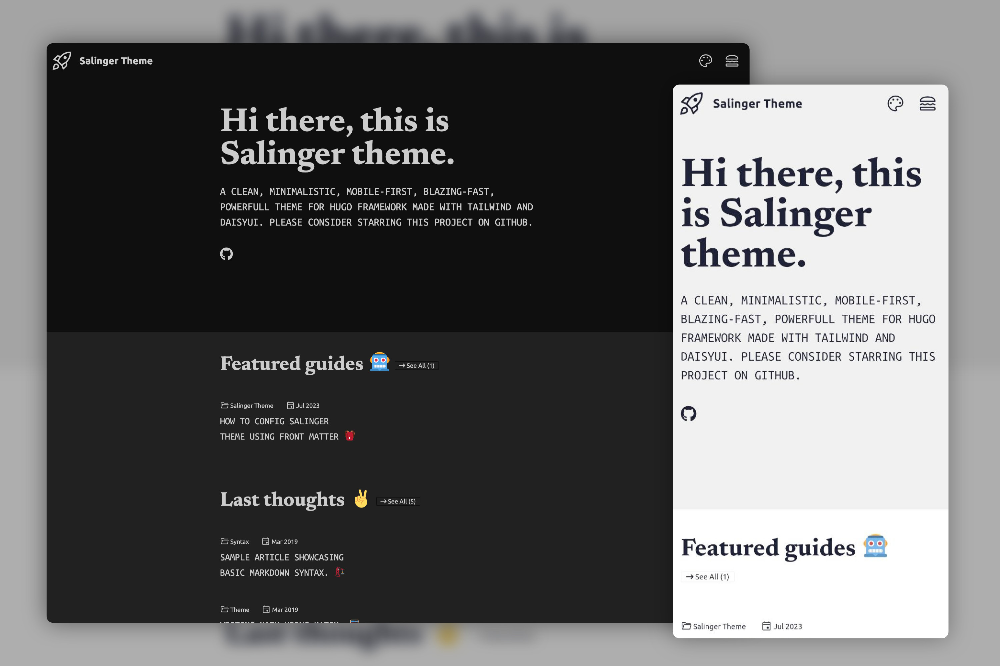

 
[](https://salinger-hugo-theme.netlify.app)

# Salinger Theme 📻

> __Salinger Theme has been featured at [_HugoConf2023_](https://www.youtube.com/watch?v=PpT8JE5BbZI)!__ 🥳

> [!NOTE]
> **v2.2.0 (November 2026): the theme builds again on recent Hugo versions.** It has been tested with Hugo **0.128.0** and **0.170.1** and now requires **Hugo ≥ 0.128.0**. Coming from v2.1.x? Read [Upgrading from v2.1.x](#upgrading-from-v21x).

___Clean and minimalistic Hugo theme built with DaisyUI and TailwindCSS.___


__Salinger__ is a _clean, minimalistic, mobile-first, blazing-fast, fancy_ and _lightweight_ theme for the [Hugo framework](https://gohugo.io).
Born as the theme for my website, recently it has been completely rebuilt using __Tailwind__ and __DaisyUI__. A demo can be seen on [the example site](https://salinger-hugo-theme.netlify.app).    
Why this name? During the design of the light mode homepage, I was inspired by [the Italian edition cover by Einaudi](https://duckduckgo.com/?q=il+giovane+holden+by+j.d.+salinger+einaudi+1961&t=h_&ia=images&iax=images&iaf=color%3AWhite) of _The Catcher in The Rye_ by J.D. Salinger.




## Features 🗂️

- [x] TailwindCSS and DaisyUI 🌼 framework 
- [x] Responsive and mobile-first 📲
- [x] Google Analytics 📈
- [x] Custom visibility of meta
- [x] __Dark, Auto__ and Light Mode 🌚
- [x] 2️⃣ hamburger Menu with custom icon
- [x] __Tweemoji__ Emoji support 🐧
- [x] SEO support (**100% score on PageSpeed**) 🚀

## Requirements 🧰

| Tool | Version | Why |
| --- | --- | --- |
| [Hugo](https://gohugo.io/installation/) | **≥ 0.128.0** (tested: 0.128.0, 0.170.1) | The standard edition is enough, the _extended_ one is not required. |
| [Node.js](https://nodejs.org/) and npm | Node **≥ 18** | Hugo runs PostCSS + Tailwind CSS through Node to build the stylesheet. |
| [Git](https://git-scm.com/) | any recent version | To add the theme as a Git submodule. |
| [Go](https://go.dev/dl/) | optional (tested: 1.27.4) | Needed **only** if you install the theme as a Hugo Module. |

You can check what you have installed with:

```bash
hugo version && node --version && npm --version && git --version
```

> [!IMPORTANT]
> The theme uses **Tailwind CSS v3** and **daisyUI v3**. The newer Tailwind CSS v4 and daisyUI v5 are **not supported yet**, so always install the major versions shown below (`tailwindcss@3`, `daisyui@3`). A plain `npm install tailwindcss` now installs v4 and the build fails.

## Quick start: preview the example site 👀

```bash
git clone https://github.com/jacksalici/salinger-theme.git salinger
cd salinger
npm install         # installs Tailwind CSS, daisyUI and PostCSS in ./node_modules
npm run example     # same as: cd example-site && hugo server -t ../..
```

Then open <http://localhost:1313/>. A live demo is also available on [the example site](https://salinger-hugo-theme.netlify.app).

> Run the example through `npm run example`: npm adds `node_modules/.bin` to the `PATH`, which is where Hugo looks for the `postcss` command.

## Install the theme in your site 🛠️

The steps below start from an empty site. If you already have a site, skip step 1 and, in step 3, merge the configuration into your own `hugo.toml` instead of overwriting it.

### 1. Create a new site (skip if you already have one)

```bash
hugo new site my-site
cd my-site
git init
```

### 2. Add the theme as a Git submodule

```bash
git submodule add https://github.com/jacksalici/salinger-theme.git themes/salinger
```

The folder name matters: the theme must be in `themes/salinger`, because that is the name used by `theme = "salinger"`.

### 3. Configure `hugo.toml`

The fastest way is to start from the configuration of the example site:

```bash
cp themes/salinger/example-site/hugo.toml hugo.toml   # overwrites the hugo.toml created by "hugo new site"
```

Whether you copy the file or edit your own, your `hugo.toml` **must** contain:

1. the theme name:

    ```toml
    theme = "salinger"
    ```

2. the following **mandatory** build configuration. Hugo writes the list of CSS classes used by your pages into `hugo_stats.json`, and Tailwind reads it to generate a stylesheet that contains only the classes you need. Without it, the site is rendered without styles.

    ```toml
    [module]
    [module.hugoVersion]
    extended = false
    min = "0.128.0"
    [[module.mounts]]
    source = "assets"
    target = "assets"
    [[module.mounts]]
    disableWatch = true
    source = "hugo_stats.json"
    target = "assets/notwatching/hugo_stats.json"

    [build]
    [build.buildStats]
    enable = true
    [[build.cachebusters]]
    source = "assets/notwatching/hugo_stats\\.json"
    target = "css"
    [[build.cachebusters]]
    source = "(postcss|tailwind)\\.config\\.js"
    target = "css"
    [[build.cachebusters]]
    source = "assets/.*\\.(js|ts|jsx|tsx)"
    target = "js"
    [[build.cachebusters]]
    source = "assets/.*\\.(.*)$"
    target = "$1"

    [markup]
    [markup.goldmark]
    [markup.goldmark.renderer]
    unsafe = true
    [markup.highlight]
    style = 'base16-snazzy'
    ```

Then customise title, menus, social links, footer, etc. All the available parameters are described in the [wiki](https://github.com/jacksalici/salinger-theme/wiki) and used in [`example-site/hugo.toml`](example-site/hugo.toml).

### 4. Install the Node.js dependencies in the site root

Run this command in the root folder of **your site** (the one that contains `hugo.toml`), not inside `themes/salinger`:

```bash
npm install --save-dev tailwindcss@3 daisyui@3 @tailwindcss/typography postcss postcss-cli@11 autoprefixer
```

This creates `package.json`, `package-lock.json` and `node_modules/` in your site. Hugo runs `node_modules/.bin/postcss` from there, and the theme's `postcss.config.js` and `tailwind.config.js` load their plugins from the same folder, so you don't need to run `npm install` inside the theme folder.

`postcss-cli@11` supports Node 18 or newer; the latest `postcss-cli` (v12) requires Node ≥ 22.

> The previous instructions used `hugo mod npm pack`. That step is no longer needed: recent Hugo versions changed its behaviour (it now creates an npm workspace in `packages/hugoautogen`), while the single command above is explicit and works the same on every supported Hugo version.

### 5. Add some content and start the server

```bash
hugo new content blog/my-first-post.md
hugo server --buildDrafts
```

Open <http://localhost:1313/>. New content is created as a draft (`draft = true`), so it is shown only with `--buildDrafts`; set `draft = false` in its front matter to publish it. To build the production site in `public/`, run `hugo --gc`.

Each section of `content/` (e.g. `content/blog/`) is listed on the home page. With the example configuration (`showOnlyFeaturedPost = true`) the home page shows only the pages with `featured = true` in their front matter, while the section page (e.g. `/blog/`) lists all of them. Have a look at [`example-site/content`](example-site/content) for complete examples of front matter (`description`, `featured`, `cover`, `toc`, `math`, ...).

We also suggest adding these generated files to your site's `.gitignore`:

```gitignore
node_modules/
public/
resources/_gen/
hugo_stats.json
.hugo_build.lock
```

### Alternative: install as a Hugo Module

If you prefer [Hugo Modules](https://gohugo.io/hugo-modules/) to Git submodules, you need [Go](https://go.dev/dl/) installed. Then:

1. Initialise your site as a module (once):

    ```bash
    hugo mod init github.com/<your-user>/<your-site>
    ```

2. In `hugo.toml`, **do not** set `theme = "salinger"`. Import the theme in the `[module]` table instead, keeping the rest of the mandatory configuration of step 3:

    ```toml
    [module]
    [[module.imports]]
    path = "github.com/jacksalici/salinger-theme/v2"
    [module.hugoVersion]
    extended = false
    min = "0.128.0"
    # ...followed by the [[module.mounts]] of step 3
    ```

3. Download the theme and install the npm dependencies as in step 4:

    ```bash
    hugo mod get -u github.com/jacksalici/salinger-theme/v2
    npm install --save-dev tailwindcss@3 daisyui@3 @tailwindcss/typography postcss postcss-cli@11 autoprefixer
    ```

### Deploying 🚀

Any host that can run Hugo and Node works. Make sure the build environment:

- uses Hugo **≥ 0.128.0** (on Netlify, set the `HUGO_VERSION` environment variable; this repository's [`netlify.toml`](netlify.toml) is a working example);
- runs `npm ci` (or `npm install`) in your site root **before** `hugo`. Netlify does it automatically when it finds a `package.json`; on other CI systems (e.g. GitHub Actions) add an `npm ci` step before the Hugo build.

## Update the theme 🔄

If you installed the theme as a submodule:

```bash
git submodule update --remote --merge themes/salinger
```

If you installed it as a Hugo Module:

```bash
hugo mod get -u github.com/jacksalici/salinger-theme/v2
```

After updating, check the [Requirements](#requirements-) and this README: if a new version needs different npm packages, rerun the command of step 4.

_Please note that during the development of the new major version (v2.x.x - Jul 23) a rebase has been made and the commit history is not so clean. If you came from the legacy version, updating it can be a bit annoying. I suggest [removing completely](https://gist.github.com/myusuf3/7f645819ded92bda6677) the submodule and adding it again._

### Upgrading from v2.1.x

v2.2.0 replaces `resources.PostCSS`, which was deprecated in Hugo 0.128.0 and is no longer available in recent Hugo versions, and fixes a bug that produced an unstyled site. To upgrade:

1. Make sure you use Hugo **≥ 0.128.0** (`hugo version`).
2. Update the theme (see above).
3. Install the npm dependencies in your site root as described in [step 4](#4-install-the-nodejs-dependencies-in-the-site-root).
4. **If you copied the theme's `layouts` folder into your site** (for example to work around the previous bug), delete those copies: files in your own `layouts/` folder override the theme, so you would keep using the old, broken templates.
5. Recommended: replace the old mandatory configuration (`writeStats = true` and the `assets/watching/hugo_stats.json` mount) with the one in [step 3](#3-configure-hugotoml). The old configuration still works (tested with Hugo 0.170.1), but the new one is what the theme is tested with.

## Troubleshooting 🩺

| Message or symptom | Cause | Solution |
| --- | --- | --- |
| `can't evaluate field PostCSS in type *resources.Namespace` | Theme older than v2.2.0 used with a recent Hugo version. | [Update the theme](#update-the-theme-). |
| `WARN deprecated: resources.PostCSS was deprecated in Hugo v0.128.0` | Same as above, with a Hugo version that still supports it. | [Update the theme](#update-the-theme-). |
| `Salinger theme: assets/css/styles.css not found` | Hugo is not loading the theme: `theme = "salinger"` is missing, or the folder is not `themes/salinger`. | Fix `theme` in `hugo.toml` or the folder name, and delete any copy of the theme's `layouts` in your site. |
| `WARN found no layout file for "html" for kind "home"` and a blank page | Hugo is not loading the theme. | As above. |
| `binary with name "postcss" not found in PATH` | npm dependencies are not installed in the folder where you run `hugo`. | Run [step 4](#4-install-the-nodejs-dependencies-in-the-site-root) in your site root. When previewing the example site, use `npm run example`. |
| `It looks like you're trying to use tailwindcss directly as a PostCSS plugin` | Tailwind CSS v4 is installed. | `npm install --save-dev tailwindcss@3 daisyui@3` |
| The site is rendered without styles (plain text, huge icons) | Tailwind did not receive the list of used classes. | Check that `[build.buildStats] enable = true` is in your `hugo.toml`, that the theme is v2.2.0 or newer, and that you are not overriding the theme's `layouts`. |

Still stuck? Please [open an issue](https://github.com/jacksalici/salinger-theme/issues) and include the output of `hugo version`, `node --version`, `npm ls --depth=0` and the full error message.

## Usage 📐

The [__wiki__](https://github.com/jacksalici/salinger-theme/wiki) documents every option of the theme:

- [Global Site Configuration](https://github.com/jacksalici/salinger-theme/wiki/Global-Site-Configuration): `hugo.toml` parameters (logo, menus, social links, footer, SEO meta tags, colors) and the mandatory build configuration;
- [Single Page Configuration](https://github.com/jacksalici/salinger-theme/wiki/Single-Page-Configuration): front matter of pages and posts (description, cover, featured, table of contents, math, ...) and the `link`, `socials` and `toc` shortcodes;
- [Homepage Settings](https://github.com/jacksalici/salinger-theme/wiki/Homepage-Settings): how the homepage is built from your sections.

The [_example site_](example-site) is a complete working example of all of them.

## License 📜

The Salinger theme code is licensed under the [MIT license](https://github.com/jacksalici/salinger-theme/blob/main/LICENSE).
